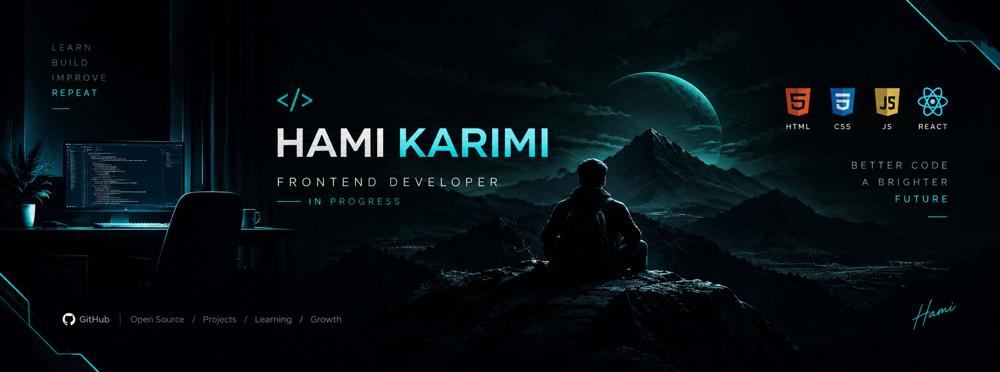

# Hey, I'm Hami 👋

### Frontend Developer in Progress

I'm learning frontend development and building projects with **HTML and CSS**, while working toward JavaScript and React.

- 🌱 Currently learning: HTML, CSS, and responsive web design
- 🛠️ Building: **Bazaarino** — a Persian RTL e-commerce website
- 🎯 Next goals: JavaScript, React, and real-world projects
- 📍 Based in: Iran

### Tech Stack

### Featured Project

**[Bazaarino](https://github.com/hami-karimi/.bazarino)**

A responsive Persian e-commerce UI built with HTML and CSS.

- Responsive layouts for desktop, tablet, and mobile
- Right-to-left layout and Persian typography
- CSS-based dark mode and mobile navigation

### Connect

- GitHub: [@hami-karimi](https://github.com/hami-karimi)
